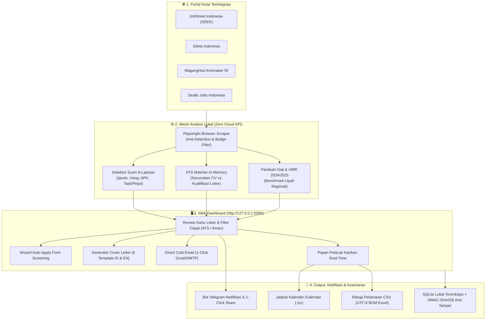

<div align="center">

# 💼 Job Hunter Copilot (`loker-cli`)

### Asisten Cerdas Pencari Kerja & Program Magang Multi-Portal di Indonesia
**100% Gratis • Bebas API Pihak Ketiga • Privasi Lokal • Anti-Scam & Red Flag Detector**

<p align="center">
  <a href="https://github.com/XT32/job-hunter-copilot/actions/workflows/test.yml">
    
  </a>
  <a href="https://www.python.org/">
    
  </a>
  <a href="https://playwright.dev/">
    
  </a>
  <a href="https://flask.palletsprojects.com/">
    
  </a>
  <a href="LICENSE">
    
  </a>
  
  
</p>

<p align="center">
  <a href="#-mengapa-job-hunter-copilot">Mengapa Copilot?</a> •
  <a href="#-fitur--kemampuan-lengkap">Fitur Lengkap</a> •
  <a href="#-arsitektur--alur-kerja-sistem">Arsitektur Alur</a> •
  <a href="#-cara-pakai-cepat-1-klik-tanpa-git">Cara Pakai Cepat</a> •
  <a href="#-keamanan-integritas-database--privasi">Keamanan & Privasi</a> •
  <a href="#-panduan-setup-bot-telegram-1-menit">Bot Telegram</a> •
  <a href="#-rangkaian-pengujian-otomatis">Unit Tests</a>
</p>

---

</div>

## 📌 Mengapa Job Hunter Copilot?

Mencari pekerjaan atau tempat pemagangan di Indonesia saat ini penuh tantangan:

1. **Banjir Lowongan Zonk & Modus Penipuan:** Marak penipuan berkedok rekrutmen seperti klausul penahanan ijazah asli, pungutan uang seragam/formulir, modus agen tiket travel fiktif BUMN, surat panggilan interview berformat file virus `.apk` di WhatsApp, deposit saldo pesanan e-commerce, hingga jebakan pendaftaran pinjaman online (pinjol) dan akun paylater.
2. **Proses Melamar yang Melelahkan:** Menyortir lowongan satu per satu di 4 portal berbeda (**JobStreet**, **Glints**, **MagangHub**, **Dealls**), mengisi pertanyaan screening berulang kali, dan menulis surat lamaran menyita waktu berjam-jam setiap hari.
3. **Ketergantungan API Berbayar:** Banyak alat rekrutmen pihak ketiga yang mengharuskan langganan OpenAI API atau layanan cloud berbayar yang memberatkan pencari kerja dan *fresh graduate*.

**Job Hunter Copilot hadir sebagai solusi 100% gratis, mandiri, dan berpusat pada privasi pengguna.** Seluruh algoritma pencocokan kata kunci, analisis skor ATS in-memory, deteksi red flag heuristik, serta manajemen pipeline disimpan **sepenuhnya di komputer Anda secara lokal** tanpa mengirimkan CV atau data pribadi ke server cloud luar mana pun.

---

## 🏗️ Arsitektur & Alur Kerja Sistem

Job Hunter Copilot dirancang dengan prinsip ***Human-in-the-Loop***: kecerdasan otomatis membantu memindai, menganalisis, dan mengisi form, tetapi keputusan akhir untuk mengirimkan lamaran tetap berada di tangan pelamar.



---

## 🌟 Fitur & Kemampuan Lengkap

### 1. 🌐 Dukungan 4 Portal Karir Terbesar di Indonesia
* **Glints Indonesia:** Pemindaian otomatis lowongan startup, agensi, dan korporat dengan dukungan tombol *Lamar Cepat*.
* **JobStreet Indonesia (SEEK):** Otomasi pencarian berbasis selektor resmi data-automation SEEK.
* **MagangHub Kemnaker:** Lowongan Program Pemagangan Nasional resmi Kementerian Ketenagakerjaan Republik Indonesia.
* **Dealls Jobs Indonesia:** Peluang kerja full-time, part-time, dan magang terkurasi.
* **Filter Badge Otomatis:** Menyingkirkan badge promosi portal (*"Baru"*, *"Mudah Dilamar"*, *"Urgent"*, *"Aktif Merekrut"*) agar tidak mencemari judul pekerjaan atau nama perusahaan.

### 2. 🛡️ Detektor Scam & Red Flag Heuristik (8 Lapisan Keamanan)
Menganalisis teks lowongan secara heuristik lokal sebelum pengguna melamar:
* ⚠️ **Klausul Tahan Ijazah Asli:** Mendeteksi syarat penahanan dokumen asli atau denda penalti sepihak.
* ⚠️ **Pungutan Biaya di Muka:** Mendeteksi uang seragam, biaya formulir, psikotes berbayar, dan modus penggantian tiket travel agen BUMN palsu.
* ⚠️ **Penyusupan File APK:** Menandai lowongan yang mengarahkan pelamar mengunduh file `.apk` mencurigakan (*surat_undangan.apk*).
* ⚠️ **Modus Tugas E-Commerce / Deposit Saldo:** Menolak skema tugas pesanan online (*like-subscribe*, top-up deposit awal).
* ⚠️ **Modus Paylater / Pinjol / Buka Rekening Fiktif:** Mendeteksi jebakan aktivasi akun kredit digital, kuota limit paylater, atau kewajiban selfie KTP dengan buku rekening.
* ⚠️ **Pialang Berjangka / Forex Bodong:** Mendeteksi perusahaan investasi komoditas berjangka terselubung.
* ⚠️ **Lokasi Rawan Interview Fiktif:** Menandai alamat ruko di kawasan rawan modus pemerasan rekrutmen (Senen, Roxy, Harmoni, dll).
* ⚠️ **Iming-iming Tanpa Seleksi:** Mendeteksi klaim tidak realistis seperti *"Pasti diterima 100%"* atau *"Kerja tanpa tes gaji jutaan per hari"*.

### 3. 🎯 Multi-CV & In-Memory ATS Matcher
* **Kelola Ragam Versi CV:** Simpan beberapa variasi CV (misal: *CV-Backend.pdf*, *CV-Finance.pdf*, *CV-Admin.pdf*) di folder `attachments/`.
* **Ganti CV Aktif 1-Klik:** Tetapkan CV aktif langsung dari antarmuka Web Dashboard.
* **Ekstraksi Kata Kunci Cerdas:** Mendukung pengenalan kata kunci teknis 2 huruf (*UI*, *UX*, *QA*, *AI*, *ML*, *Go*, *JS*, *TS*, *IT*, *HR*) serta simbol khusus (*C++*, *C#*, *.NET*).
* **Skor Kecocokan ATS:** Menghitung persentase kecocokan kualifikasi CV terhadap deskripsi pekerjaan secara instan dan menampilkan saran kata kunci yang perlu ditambahkan.

### 4. 💰 Panduan Standar Gaji & Rekomendasi UMR 2024/2025
* **Database UMR/UMK Resmi:** Memuat data upah minimum untuk DKI Jakarta, Bodetabek, Karawang, Surabaya, Bandung, Semarang, Yogyakarta, Medan, Bali, Makassar, Balikpapan, hingga Jayapura.
* **Kalkulator Rentang Gaji Sehat:** Memberikan rekomendasi rentang gaji realistis berdasarkan level pengalaman (*Internship*, *Fresh Graduate*, *Junior*, *Mid*, *Senior*) agar pelamar terhindar dari mengisi angka di bawah upah layak.

### 5. 🤖 Auto-Fill Pertanyaan Screening & Wizard Formulir
* Mengisi kuesioner umum saat pop-up lamaran muncul di portal:
  * Ekspektasi gaji default.
  * Notice period (waktu mulai bekerja).
  * Lama pengalaman kerja (tahun).
  * Kota domisili & kesediaan bekerja di kantor (WFO).
* **Bank Tanya-Jawab Kustom (QA Bank):** Pengguna dapat menyimpan jawaban khusus untuk pertanyaan yang sering ditanyakan perusahaan.

### 6. 📄 Generator Cover Letter (6 Template ID & EN) + Unduh `.txt`
* Membuat surat lamaran otomatis yang dipersonalisasi sesuai nama pelamar, nama perusahaan, jurusan, dan keahlian:
  * 🇮🇩 **Formal & Profesional** (Standar Korporat & BUMN)
  * 🇮🇩 **Fresh Graduate** (Antusiasme & Kecepatan Belajar)
  * 🇮🇩 **Program Pemagangan** (Khusus MagangHub Kemnaker & Kampus)
  * 🇬🇧 **English Corporate** (Multinational & Enterprise)
  * 🇬🇧 **English Fresh Graduate** (Tech Companies & Startups)
  * 🇬🇧 **English Internship** (Internship Coordinator & Trainee Program)
* **1-Klik Unduh Berkas `.txt`:** Simpan surat lamaran langsung ke format teks terstruktur tanpa perlu menyalin manual.

### 7. 📧 Direct Cold Email (1-Click Gmail Web, Mailto & SMTP)
* **🌐 Buka di Gmail Web (1-Klik):** Membuka tab draf pesan baru di browser dengan alamat email HRD, subjek, dan isi surat lamaran yang sudah terisi otomatis tanpa perlu setup kata sandi aplikasi.
* **✉️ Buka Mail App (Mailto):** Membuka aplikasi email default komputer (Outlook, Thunderbird, Apple Mail).
* **⚙️ Kirim via SMTP Otomatis:** Opsi pengiriman email otomatis via server SMTP dengan dukungan Port 465 (SSL) dan Port 587 (TLS / STARTTLS) beserta lampiran file PDF CV aktif.

### 8. 📋 Papan Pelacak Status Lamaran (Kanban Pipeline & Analytics)
* **4 Kolom Pipeline:** 📨 *Terkirim (Applied)*, 💬 *Panggilan Interview*, 🏆 *Offering / Diterima*, dan ❌ *Ditolak / Gugur*.
* **Pencarian Real-Time:** Filter kartu lowongan berdasarkan posisi, perusahaan, atau catatan secara instan tanpa limit kuota.
* **Manajemen Fleksibel:** Edit catatan (link Zoom, kontak HR), hapus kartu lamaran, atau bersihkan seluruh riwayat lamaran yang ditolak dengan 1 klik.
* **Mini Analytics:** Ringkasan total lamaran terkirim, tingkat respons wawancara (*response rate*), dan persentase penawaran.

### 9. 📲 Integrasi Bot Telegram & Pengingat Wawancara
* **1-Klik Bagikan Loker ke Telegram:** Temukan loker menarik di browser? Klik tombol `📲 Telegram` pada kartu lowongan untuk mengirim ringkasan lengkap langsung ke chat bot Telegram Anda.
* **Pengingat Jadwal Wawancara Otomatis:** Setiap kali Anda menjadwalkan wawancara di papan Kanban, bot Telegram akan mengirimkan kartu pengingat yang memuat posisi, perusahaan, tanggal/jam, lokasi/link virtual meet, serta catatan penting.
* **Tombol Uji Koneksi:** Tes sambungan token bot dan chat ID secara instan langsung dari menu pengaturan Dashboard.

### 10. 📅 Kalender iCalendar (.ics) & Ekspor Excel Ramah Karakter (`utf-8-sig`)
* **Ekspor Kalender Wawancara (.ics):** Unduh jadwal wawancara kerja dalam format standar RFC 5545 untuk diimpor ke Google Calendar, Outlook, atau Apple Calendar.
* **Ekspor CSV Kompatibel Excel:** File CSV hasil ekspor dilengkapi penanda UTF-8 BOM (`utf-8-sig`) dan kolom `Platform` lengkap agar terbuka rapi tanpa teks berantakan di Microsoft Excel.

### 11. 💾 Cadangan Data & Pemulihan Penuh (Backup & Restore JSON)
* **Cadangkan 1-Klik:** Unduh seluruh konfigurasi profil, pengaturan screening, bank QA, dan riwayat lamaran dalam satu file `backup_loker_cli.json`.
* **Pulihkan 1-Klik:** Unggah kembali berkas cadangan saat berganti komputer atau install ulang tanpa kehilangan data riwayat atau konfigurasi.

---

## 📥 Cara Pakai Cepat (1-Klik Tanpa Git)

Bagi pengguna umum yang **tidak memiliki Git** atau **tidak terbiasa dengan terminal**:

1. Unduh repositori ini dalam bentuk file ZIP:
   👉 **[Download Source Code (ZIP)](https://github.com/XT32/job-hunter-copilot/archive/refs/heads/main.zip)**
2. Ekstrak file ZIP tersebut ke folder komputer Anda (misal di folder *Documents* atau *Desktop*).
3. Buka foldernya, kemudian:
   * **Di Windows:** Klik dua kali file **`start_windows.bat`** (atau `start_web_windows.bat`).
   * **Di Linux / macOS:** Buka terminal dan jalankan:
     ```bash
     chmod +x start_linux.sh
     ./start_linux.sh
     ```
4. Skrip peluncur akan otomatis menyiapkan environment Python, memasang dependensi, dan membuka Web Dashboard di browser Anda (`http://127.0.0.1:5000`).

> 💡 **Persyaratan Sistem:** Pastikan komputer sudah terpasang [Python](https://www.python.org/downloads/) versi 3.10 atau lebih baru. Di Windows, pastikan mencentang kotak **"Add python.exe to PATH"** saat menginstall Python.

---

## 💻 Panduan Pengguna Pengembang (Developer Guide)

### 1. Clone & Setup Virtual Environment
```bash
# Clone repositori
git clone https://github.com/XT32/job-hunter-copilot.git
cd job-hunter-copilot

# Buat virtual environment
python3 -m venv .venv

# Aktifkan virtual environment
# Di Linux / macOS:
source .venv/bin/activate
# Di Windows:
# .venv\Scripts\activate.bat

# Pasang dependensi
pip install -r requirements.txt
playwright install chromium
```

### 2. Menjalankan Dashboard
```bash
python3 web_app.py
```
Akses dashboard di browser Anda: `http://127.0.0.1:5000`.

### 3. Variabel Lingkungan (Opsional)
Aplikasi mendukung konfigurasi fleksibel melalui environment variables:
| Variabel | Default | Keterangan |
| :--- | :--- | :--- |
| `PORT` | `5000` | Port HTTP yang digunakan oleh Flask server. |
| `HOST` | `127.0.0.1` | Alamat binding server (`0.0.0.0` jika ingin diakses dari jaringan lokal). |
| `AUTO_OPEN` | `true` | Otomatis membuka peramban saat server dimulai (`false` untuk lingkungan headless/server). |

---

## 🤖 Panduan Setup Bot Telegram (1 Menit)

Agar dapat menerima notifikasi loker dan pengingat wawancara di ponsel Anda:

1. **Buat Bot Baru di Telegram:**
   * Buka aplikasi Telegram, cari akun resmi **`@BotFather`**.
   * Kirim perintah `/newbot`, lalu ikuti instruksi untuk memberi nama dan username bot Anda.
   * Salin **HTTP API Token** yang diberikan (format: `123456789:ABCdefGhIJKlmNoPQRsTUVwxyZ`).
2. **Dapatkan Chat ID Anda:**
   * Cari bot **`@userinfobot`** di Telegram, lalu klik *Start*.
   * Bot akan menampilkan **Id** angka Anda (misal: `987654321`).
3. **Aktifkan di Dashboard:**
   * Buka Web Dashboard Job Hunter Copilot, buka tab **Profil & Pengaturan**.
   * Centang **"Aktifkan Notifikasi Bot Telegram"**.
   * Masukkan *Bot Token* dan *Chat ID*, lalu klik tombol **🧪 Tes Sambungan ke Telegram**.
   * Anda akan menerima pesan konfirmasi di Telegram ponsel Anda!

---

## 🛡️ Keamanan, Integritas Database & Privasi

* **Zero Telemetry & 100% Data Lokal:** File CV (`attachments/`), basis data riwayat (`data/`), dan konfigurasi disimpan lokal di komputer Anda. Direktori data sensitif dilindungi `.gitignore` sehingga tidak pernah terunggah ke internet.
* **Database SQLite Bersegel HMAC-SHA256:** Integritas database dilindungi segel kriptografis HMAC (`data/security_seal.json`) dan backup snapshot terenkripsi. Jika terjadi manipulasi berkas database dari luar UI, sistem secara otomatis mendeteksi tanda bahaya (*tamper warning*) dan memulihkan snapshot sah terakhir.
* **Proteksi CSRF & Origin Dinamis:** Seluruh aksi pengubah status diproteksi token CSRF ganda dan verifikasi Origin yang mendukung domain reverse proxy lokal (`.local`, `.test`, `.lan`, atau IP privat).
* **Anti-Deteksi Peramban:** Menggunakan Playwright dengan flag stealth Chromium khusus dan isolasi sesi login (`user_browser_data/`) agar akun portal Anda tidak mudah terblokir.

---

## 📂 Struktur Berkas Proyek

```text
job-hunter-copilot/
├── attachments/             # Penyimpanan berkas PDF CV pelamar (diabaikan git)
├── config/
│   └── config.json          # Berkas konfigurasi profil, screening, & bot
├── data/
│   ├── loker_history.db     # Database SQLite lokal terenkripsi
│   ├── security_seal.json   # Segel HMAC-SHA256 integritas database
│   └── backup_loker_cli.json# Cadangan data JSON pengguna
├── src/
│   ├── base_hunter.py       # Kelas dasar scraper Playwright
│   ├── browser.py           # Inisialisasi context peramban & flags stealth
│   ├── config.py            # Logika pembacaan & penyimpanan config aman
│   ├── cover_letter.py      # Generator surat lamaran 6 template (ID & EN)
│   ├── cv_analyzer.py       # Parser PDF, ekstraksi kata kunci & skor ATS
│   ├── dealls.py            # Modul scraper portal Dealls Jobs
│   ├── diagnostic.py        # Diagnostik konektivitas portal & bundle debug
│   ├── email_sender.py      # Pengirim email SMTP (SSL & STARTTLS)
│   ├── glints.py            # Modul scraper portal Glints Indonesia
│   ├── jobstreet.py         # Modul scraper & wizard lamaran JobStreet SEEK
│   ├── local_db.py          # Lapisan database SQLite dengan HMAC anti-tamper
│   ├── maganghub.py         # Modul scraper portal MagangHub Kemnaker
│   ├── matcher.py           # Pencocok kata kunci profil & batas pengalaman
│   ├── notifier.py          # Notifikasi & alert lowongan bot Telegram
│   ├── rate_limiter.py      # Pembatas laju pelamaran (anti-spam / kuota aman)
│   ├── salary_guide.py      # Database UMR/UMK 2024/2025 & panduan gaji
│   ├── scam_detector.py     # Detektor red flag & modus penipuan 8-lapisan
│   ├── scheduler.py         # Background scheduler pemindaian otomatis
│   ├── screener.py          # Pengisi otomatis pertanyaan screening formulir
│   ├── storage.py           # Abstraksi antarmuka penyimpanan & ekspor CSV/ICS
│   └── updater.py           # Pemeriksa pembaruan rilis repositori
├── static/
│   └── js/app.js            # Logika antarmuka Web UI, filter, & integrasi API
├── templates/
│   └── index.html           # Tampilan visual dashboard Web (Tab 1 - Tab 5)
├── tests/                   # 21 berkas unit test lengkap (84 pengujian)
├── start_windows.bat        # Skrip peluncur cepat 1-klik untuk Windows
├── start_linux.sh           # Skrip peluncur cepat 1-klik untuk Linux/macOS
├── web_app.py               # Server aplikasi Web Dashboard Flask
└── requirements.txt         # Daftar pustaka Python yang dibutuhkan
```

---

## 🧪 Rangkaian Pengujian Otomatis

Repositori ini dilengkapi rangkaian **84 unit tests mandiri** yang mencakup seluruh lapisan sistem (penguraian PDF, pencocokan kata kunci, deteksi scam, keamanan HMAC database, origin CSRF, integrasi email, kalender, hingga scheduler):

```bash
python3 -m unittest discover tests -v
```

Semua pengujian berjalan secara berkala pada pipeline CI GitHub Actions lintas sistem operasi (**Ubuntu** dan **Windows**) dengan matriks versi Python **3.10**, **3.11**, dan **3.12**.

---

## ⚖️ Etika Penggunaan & Disclaimer

1. **Penggunaan yang Bertanggung Jawab:** Aplikasi ini dibuat untuk membantu pencari kerja menghemat waktu secara terhormat. Hindari melakukan *spamming* massal atau mengabaikan relevansi kualifikasi lowongan.
2. **Kepatuhan Terhadap Layanan Pihak Ketiga:** Otomasi beroperasi melalui peramban yang Anda kendalikan sendiri (*human-in-the-loop*). Pengguna bertanggung jawab penuh atas aktivitas akun dan kepatuhan terhadap *Terms of Service* masing-masing portal kerja.
3. **Perlindungan Terbuka & Bebas Komersial Tertutup:** Proyek ini berlisensi resmi GNU Affero General Public License v3 (AGPL-3.0) untuk memastikan seluruh kode dan modifikasinya selamanya terbuka, gratis, dan terlindungi dari eksploitasi produk komersial tertutup (closed-source SaaS wrapper).

---

## 🤝 Kontribusi

Kontribusi dari komunitas sangat dinantikan! Baik berupa perbaikan selektor portal, penambahan pola detektor penipuan baru, maupun penyempurnaan fitur:

1. Fork repositori ini.
2. Buat branch fitur baru (`git checkout -b fitur/nama-fitur`).
3. Commit perubahan Anda (`git commit -m "feat: tambah fitur keren"`).
4. Pastikan semua unit test lolos (`python3 -m unittest discover tests -v`).
5. Push ke branch Anda (`git push origin fitur/nama-fitur`) dan buat *Pull Request*.

Silakan baca panduan lengkap pada [CONTRIBUTING.md](CONTRIBUTING.md).

---

## 📄 Lisensi

Didistribusikan di bawah lisensi resmi **[GNU Affero General Public License v3 (AGPL-3.0)](LICENSE)**. Hak cipta dilindungi undang-undang.
